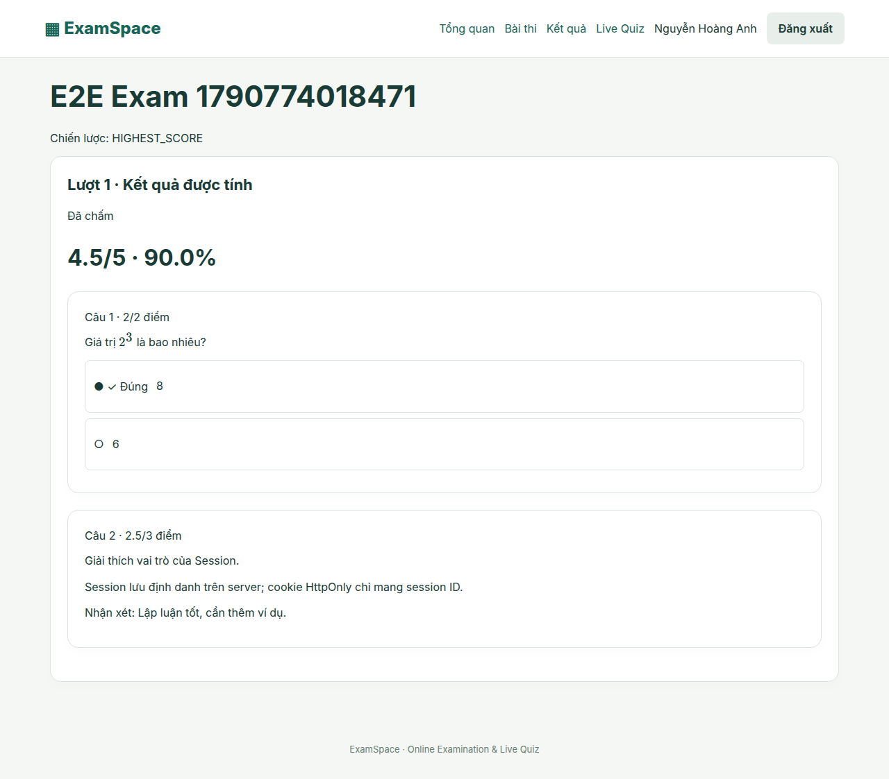
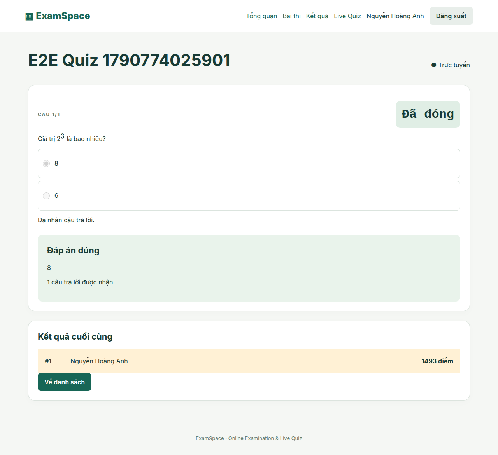

# ExamSpace — Thi trực tuyến & Live Quiz

Bài tập lớn môn Công nghệ Web và Dịch vụ trực tuyến. Giảng viên soạn câu hỏi, tổ chức thi và Live Quiz; sinh viên làm bài, tiến độ được lưu liên tục; quản trị viên quản lý tài khoản. Dữ liệu và session nằm trên PostgreSQL thật; repo có migrations, seed demo và bộ kiểm thử trình duyệt.

**Staging:** https://examspace-staging-rc.onrender.com, gồm frontend và API trên cùng origin. Xem [mục Deployment](#deployment).

## Tính năng

- **Tài khoản:** ADMIN/TEACHER/STUDENT, Argon2id, session lưu trong PostgreSQL, RBAC và kiểm tra quyền sở hữu, khóa tài khoản, CSRF, CORS theo origin chính xác. Session hết hạn thì SPA tự đưa về màn hình đăng nhập.
- **Lớp và ngân hàng câu hỏi:** danh sách lớp, 4 loại câu hỏi, Markdown/GFM/LaTeX/code. Ảnh lưu trong Supabase Storage private và chỉ đi qua backend. Ảnh tải lỗi có nút **Thử lại** để xin lại signed URL.
- **Đề thi:**
  - Builder 5 bước, giao cho lớp, đặt lịch, thời lượng, số lượt; câu cố định kết hợp random pool, xáo trộn câu.
  - Snapshot đề khi bắt đầu làm bài, timer phía server.
  - Server kiểm tra cấu hình trước khi publish. Builder chặn rời trang khi còn thay đổi chưa lưu.
- **Làm bài:** autosave có retry; đáp án chưa gửi được lên server được giữ tạm trong trình duyệt và khôi phục khi mở lại. Nộp bài idempotent; tự nộp khi hết giờ.
- **Chấm và kết quả:** tự chấm câu khách quan, chấm tự luận thủ công kèm nhận xét. Công bố điểm ngay, sau khi đóng đề hoặc thủ công. Theo dõi realtime, thống kê, xuất Excel và PDF tiếng Việt.
- **Live Quiz:** phòng mã 6 số, lobby, câu hỏi và deadline realtime, chấm điểm ở server, bảng xếp hạng, kết nối lại sau khi rớt mạng, hỗ trợ reduced motion.

## Kiến trúc

React 19 + TypeScript + Vite 8 + Tailwind 4 + TanStack Query + React Hook Form/Zod. Express 5 + Socket.IO 4 chạy chung một HTTP server; Prisma 7/pg + PostgreSQL lưu nghiệp vụ và session. Supabase Storage private chứa ảnh; ExcelJS và PDFKit xuất báo cáo. Frontend không quyết định danh tính, thời gian hay điểm số, và không chứa service key.

Khi deploy, **một Node service phục vụ cả SPA, REST `/api/v1` và Socket.IO trên cùng origin** (`SERVE_WEB=true`). GitHub Pages (`pages.yml`) chỉ là phương án phụ cho kiểu frontend/backend tách origin.

```text
apps/api/          API, sockets, jobs, Prisma schema/migrations/seed, fonts, CA
apps/web/          React SPA: routes theo role, editor, Exam, Quiz, analytics
packages/shared/   Schemas, DTOs, enums, typed socket events
tests/             Playwright E2E, UI suites, deployment smoke và probes
docs/              SRS, SDD, deployment, audits, design system, archive
.github/workflows/ CI (ci.yml) và Pages thủ công (pages.yml)
render.yaml        Render Blueprint: một Web Service phục vụ SPA + API
```

## Chạy local

Cần Node 22 LTS (≥22.12) và PostgreSQL UTF8, hoặc một Supabase project dùng cho development.

```bash
npm ci
cp apps/api/.env.example apps/api/.env
cp apps/web/.env.example apps/web/.env
node -e "console.log(require('node:crypto').randomBytes(48).toString('hex'))"
```

Điền `DATABASE_URL`, `SESSION_SECRET` (chuỗi vừa sinh) và tùy chọn `DIRECT_URL` vào `apps/api/.env`. Muốn dùng ảnh thì thêm `SUPABASE_URL`, `SUPABASE_SERVICE_ROLE_KEY` và tạo bucket private `question-assets`. Không đặt secret vào biến `VITE_*`.

```bash
npm run db:generate
npm run db:migrate
npm run db:seed
npm run dev
```

Web chạy ở `http://localhost:5173`, API health ở `http://localhost:3000/api/health`. Thiếu cấu hình Storage thì các luồng không có ảnh vẫn chạy, còn upload trả 503. Bảng biến môi trường đầy đủ xem trong [DEPLOYMENT](docs/DEPLOYMENT.md).

## Tài khoản demo — chỉ dùng cho development

Mật khẩu mặc định là **DevOnly!2026**:

| Role    | Email                                      |
| ------- | ------------------------------------------ |
| ADMIN   | admin@exam.local                           |
| TEACHER | teacher1@exam.local, teacher2@exam.local   |
| STUDENT | student1@exam.local … student12@exam.local |

Seed tạo 1 admin, 2 giảng viên, 12 sinh viên, 2 lớp, 2 ngân hàng, 24 câu đủ 4 loại, 3 đề thi và 1 Live Quiz; có sẵn kết quả mẫu của student2. Seed idempotent, không ghi đè dữ liệu đã có. Không dùng mật khẩu này trên môi trường thật.

## Lệnh và kiểm thử

| Lệnh                       | Công dụng                                                          |
| -------------------------- | ------------------------------------------------------------------ |
| `npm run dev`              | API + Vite                                                         |
| `npm run db:generate`      | Sinh Prisma client                                                 |
| `npm run db:migrate`       | Áp dụng migrations đã commit, không reset                          |
| `npm run db:seed`          | Dữ liệu development                                                |
| `npm run lint`             | ESLint                                                             |
| `npm run typecheck`        | TypeScript strict cho app và tests                                 |
| `npm test`                 | Unit/frontend (Vitest)                                             |
| `npm run test:integration` | API và socket với PostgreSQL thật, ranh giới Storage               |
| `npm run test:e2e`         | 4 nhóm Playwright: core, Student Exam, Session Recovery, Builder blockers |
| `npm run test:deployment`  | Smoke production bundle: SPA subpath/404/refresh, đăng nhập, PDF   |
| `npm run build`            | Build shared + API + web                                           |

Integration và E2E cần `TEST_DATABASE_URL` trỏ tới một DB riêng có chữ `test` trong tên, đã migrate và seed; cần thêm `pdftotext` (poppler-utils) và `npx playwright install --with-deps chromium`. Không chạy test vào DB production. Các bước chuẩn bị xem tại [DEPLOYMENT](docs/DEPLOYMENT.md#kiểm-thử).

Các bộ UI riêng trong `tests/ui/` chạy bằng `npx playwright test --config=playwright.ui.config.ts` (Chromium, locale `vi-VN`, timezone `Asia/Bangkok`). Chúng dùng để chụp lại ảnh giao diện, không nằm trong CI.

**Kết quả kiểm thử gần nhất:**

| Bộ | Kết quả |
| --- | --- |
| `npm test` | **166/166 qua, 25 file**. Đã chạy trên commit `7f38176` |
| `npm run test:integration` | 82/82 qua, 18 file. Theo báo cáo 03/11/2026, **chưa chạy lại** |
| `npm run test:e2e` | 56/56 qua (core 22, Student Exam 25, Session Recovery 3, Builder blockers 6). Theo báo cáo 03/11/2026, **chưa chạy lại** |

Chi tiết xem [báo cáo release 03/11/2026](docs/audits/FINAL_RELEASE_READINESS_20261103.md).

## Ảnh giao diện

Chụp bằng Playwright với API và PostgreSQL thật.





## Deployment

- **Kiến trúc:** một Render Web Service (`render.yaml`) build cả API và web, rồi Express phục vụ SPA, REST và WebSocket trên cùng origin. Cookie `Secure`, `SameSite=lax`. PostgreSQL và Storage dùng Supabase.
- **Staging hiện tại:** https://examspace-staging-rc.onrender.com.
- **Hướng dẫn:** [runbook deploy](docs/deployment/FREE_STAGING_RUNBOOK.md) là tài liệu thao tác chính; [DEPLOYMENT](docs/DEPLOYMENT.md) có hướng dẫn đầy đủ và troubleshooting; [environment matrix](docs/deployment/ENVIRONMENT_MATRIX.md) là bảng biến môi trường.
- **Lưu ý:**
  - Blueprint đang để auto-deploy tắt; mỗi lần deploy phải chọn đúng branch/commit trên dashboard.
  - Lệnh start không chạy migrate hay seed.
  - Gói free sẽ ngủ sau 15 phút không có truy cập, nên không dùng cho kỳ thi thật.

## Tài liệu

| Tài liệu | Nội dung |
| --- | --- |
| [SRS](docs/SRS.md) | Yêu cầu chức năng và traceability |
| [SDD](docs/SDD.md) | Thiết kế: kiến trúc, ERD, sequence, state machine |
| [DEPLOYMENT](docs/DEPLOYMENT.md) | Local, Supabase, Render, phương án Pages, troubleshooting |
| [Runbook deploy](docs/deployment/FREE_STAGING_RUNBOOK.md) | Các bước deploy staging |
| [Environment matrix](docs/deployment/ENVIRONMENT_MATRIX.md) | Bảng biến môi trường |
| [Báo cáo release 03/11](docs/audits/FINAL_RELEASE_READINESS_20261103.md) | Kết quả kiểm thử và các gate còn mở |
| [VERIFICATION](docs/VERIFICATION.md) | Đối chiếu Definition of Done |
| [Implementation checklist](docs/IMPLEMENTATION_CHECKLIST.md) | Tiến độ theo phase |
| [Design system](docs/ux/DESIGN_SYSTEM.md) | Token và quy tắc giao diện |
| [Lịch sử khắc phục lỗi](docs/remediation/REMEDIATION_HISTORY.md) | Các đợt sửa lỗi sau audit |
| [MASTER_SPEC](docs/spec/MASTER_SPEC_BASELINE.md) | Đặc tả nghiệp vụ gốc |
| [Archive](docs/archive/README.md) | Báo cáo lịch sử |

**Giới hạn v1:**
- Chỉ chạy một API instance; chưa có horizontal scaling hay load test.
- Đề bị khóa cấu hình sau lượt làm bài đầu tiên.
- Khi API ngừng hoạt động, deadline không được kéo dài. Đáp án chưa lên server chỉ còn trong trình duyệt đang dùng: khôi phục được khi mở lại trên cùng máy, nhưng không được tính nếu hết giờ trước khi gửi được.
