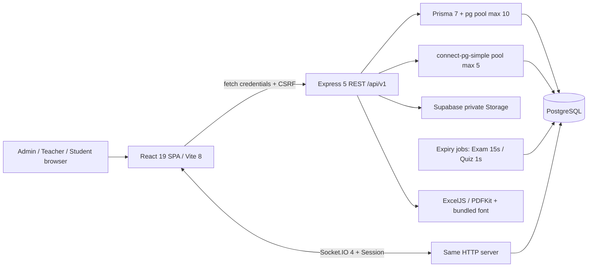

# ExamSpace — System-wide audit & pre-deployment readiness

Ngày audit: **12/10/2026, Asia/Bangkok**. Baseline: `04f99e305c89f17e6ee98ed1ea78124c260d601d`. Mode: **AUDIT ONLY — COMPLETE**. Báo cáo này không cấp phép remediation/deploy.

## 1. Executive summary

Core API có nền tảng tốt: PostgreSQL thật, server-side session, kiểm tra role/ownership, snapshot, timer/scoring server, transactions và test biên nghiệp vụ. **Chưa đủ điều kiện chốt release/handoff**: **Admin lock/unlock và đổi role đang bị lỗi P1**; CI hiện fail ở dependency advisory và một E2E locator cũ; một số workflow quản lý bị giới hạn trang đầu; cloud authentication/Storage chưa được xác minh cho deployment dự kiến.

Tổng **9 findings: 0 P0, 1 P1, 7 P2, 1 P3**. Không phát hiện P0 từ evidence đã thu thập. Không diễn giải advisory có nhãn critical thành khai thác remote đã xác nhận trên ExamSpace. Findings chi tiết, mức ưu tiên và remediation chưa thực hiện ở [EXAMSPACE_FINDINGS.md](EXAMSPACE_FINDINGS.md); dữ liệu máy đọc ở [EXAMSPACE_RELEASE_READINESS.json](EXAMSPACE_RELEASE_READINESS.json).

Kết quả API/integration không thay thế kiểm thử browser. Ngược lại, screenshot không chứng minh authorization. PASS trong báo cáo chỉ áp dụng các assertion/scenario được nêu, không có nghĩa mọi state của module đều được kiểm thử đầy đủ.

## 2. Git baseline và continuity

- Repository: `https://github.com/LAMB-IS-ME/BTL-CNW-DVTT`.
- Branch: `ux/education-saas-redesign-pilot`.
- HEAD: `04f99e305c89f17e6ee98ed1ea78124c260d601d`, `feat(ui): roll out live quiz experience`.
- Working tree ban đầu sạch; lần resume cuối chỉ có audit artifacts chưa tracked, HEAD khớp baseline. Không reset/checkout/discard.
- Recent commits: `04f99e3` Live Quiz; `e236cb8` Grading/Results; `2444199` Focus Desk; `f22be07` Exam Folio; `4e70c65` Dashboard/Question Bank.
- Sau gián đoạn, scratch `<temporary-audit-workspace>` không còn. Lint/typecheck/unit/build đã có kết quả exit 0 trong hội thoại nhưng raw logs mất; không giả định integration/E2E trước gián đoạn đã hoàn tất.
- Source/test được copy từ danh sách `git ls-files` vào scratch, dependencies dùng lại qua symlink, Prisma generated client copy từ local. Không copy `.env`. Hai file spec local không tracked được đọc trực tiếp và chỉ lưu hash/provenance.
- Bản sao giúp tests cũ ghi screenshots/report vào scratch, không ghi đè approved boards. Vite audit wrapper chỉ cho phép đọc dependencies symlink để fonts được phục vụ đúng; không thay runtime behavior.
- Node `22.23.2`, npm `10.9.8`, PostgreSQL `16.15` UTF8, Chromium cache sẵn; `pdftotext` có sẵn. PostgreSQL packages giải nén trong `/tmp`, không cài hệ thống. DB riêng `examspace_audit_test`, chỉ loopback. Mọi tài khoản/dữ liệu mới là synthetic.

[Source manifest](evidence/source-manifest.json) ghi hash source và spec. Không dùng production DB, bucket hay domain.

## 3. Architecture thực tế

**Frontend:** React Router `createBrowserRouter`, role `Guard`, lazy route modules; TanStack Query cache mặc định `staleTime=10s`, RHF/Zod ở auth và shared schemas. API wrapper bật `credentials: include`, CSRF bootstrap/rotate; download dùng blob. Logout `cache.clear()`. Scope CSS riêng Dashboard/Question Bank/Folio/Focus/Grading/Quiz; shared header còn dùng ở Admin, Classes và một số Teacher routes. Markdown qua ReactMarkdown/GFM/math/highlight, không bật raw HTML. `asset:` được dịch thành signed URL phía backend.

**Backend:** Express route modules auth/admin/classes/question-banks/exams/attempts/grading/results/analytics/exports/storage/live-quiz. Argon2id password verification; database session; `authenticate` đọc status/role từ DB mỗi request. Helmet, exact CORS, Origin + CSRF cho mutation, Zod validation, JSON 1 MB, upload 5 MB. Auth rate limit 30/15 phút theo IP; Quiz lookup 20/phút; socket packet/auth checks. Lỗi chuẩn hóa, không trả stack/credential. Health là liveness, không xác minh DB readiness.

**Database:** Prisma schema có **22 models/bảng ứng dụng, gồm session**; docs cũ gọi “21 bảng” là drift. Hai committed migrations: initial và integrity; RLS trên các bảng app, không anonymous policy. Runtime role phải có quyền phù hợp/table owner hoặc BYPASSRLS. Unique memberships, one answer/question, attempt number; partial unique một IN_PROGRESS/student/exam; CHECK điểm/lịch. Exam row lock khi Start; Attempt lock save/submit/grade; Quiz room lock; catalog advisory lock chống archive/pool races. Transaction maxWait 5s/timeout 15s. Không migration/schema mới.

**Snapshot:** Publish kiểm tra nguồn khả thi, **không đóng băng toàn đề ở Publish**. `AttemptQuestion.snapshotJson` materialize ở Start; LiveRoomQuestion ở host Start. Shuffle và mapping được lưu cùng snapshot. Câu hỏi ngân hàng chỉnh sau đó không sửa snapshot cũ. Đây là implementation đã định nghĩa trong MASTER_SPEC §11/40, không báo thiếu “published snapshot” như bug.

**Storage:** Supabase SDK service role chỉ backend; PNG/JPEG/WebP signature + MIME, giới hạn 5 MB; đường dẫn UUID/owner/question. GET asset kiểm tra owner hoặc reference thực trong attempt/room, explanation qua release/reveal; signed URL 300s. Không local-file fallback. External private-bucket behavior chưa được kiểm chứng trong audit này. AssetImage hiện thiếu UI lỗi/retry riêng khi URL/ảnh lỗi; xem finding ảnh.

**Realtime:** Socket.IO dùng cùng HTTP server và session middleware; handshake Origin allowlist, per-event session reload và ACTIVE role; ownership/membership tại service. Rooms monitor/attempt/quiz/user/session. State cá nhân hóa ownAnswer; DB quyết định deadline, accepted answer, scoring. Presence/rate limit/event bus trong process; không Redis adapter, không multi-instance support. Snapshot protocol chưa có sequence/version; đây là risk kiến trúc, không phải bug đã tái hiện trong audit.

## 4. Feature inventory theo role

Inventory đầy đủ gồm route, API, permission, dependencies, tests, states, status và limitation ở [feature-inventory.json](evidence/feature-inventory.json). API paths tương đối `/api/v1`.

| Role | Nhóm chức năng | Verification |
|---|---|---|
| ALL | Register/login/logout/session, Guard | Auth integration PASS; expired-session UX xem findings |
| Admin | Overview, user list/search/filter/pager, create | Create/search browser + API PASS; form constraints/source reviewed |
| Admin | Lock/unlock, non-self role change | **FAIL — ADMIN-001 P1**; actor/dependency guards sau SQL chưa được thực thi thành công |
| Admin | Class overview | API có pages; UI không có pager; PARTIAL |
| Admin | Edit identity/password reset | NOT IMPLEMENTED; không phải core requirement của local spec |
| Teacher | Dashboard, Bank, four types, archive/restore | Integration + existing Question Bank E2E PASS |
| Teacher | Class/roster | API workflow PASS; list/cache limitations |
| Teacher | Exam builder/publish/fixed/random/shuffle | Integration PASS; list/pickers có giới hạn gây thiếu dữ liệu UI |
| Teacher | Monitoring, essay grading, release, results, analytics, PDF/Excel | Integration PASS; tracked core E2E bị stale locator |
| Teacher/Student | Live Quiz lifecycle/reconnect/answer/reveal/final | 7 Chromium cases PASS, Teacher + hai Student contexts |
| Student | Discovery/start/autosave/timer/resume/submit | Integration + browser workflow; không có durable offline queue |
| Student | Results/history/release visibility | Integration PASS; history index phụ thuộc membership hiện tại |

## 5. Admin audit

Source thực có ba routes `/admin`, `/admin/users`, `/admin/classes`; không invent moderation Exam hay LMS. Overview đếm users/classes/exams/quizzes. User API có pagination/search/role, chỉ select DTO không password hash. Create dùng registerSchema và role enum; browser form có required/email/minLength10. API authorization được integration kiểm tra độc lập UI; browser bổ sung create/search account. Admin class list không có pager (SYS-001). Field validation/source review không đồng nghĩa mọi invalid form case đã chạy browser.

**ADMIN-001 P1: non-self status/role PATCH trả500, dữ liệu không đổi.** Hai chỗ `admin/routes.ts:51,73` dùng `$queryRaw` với `pg_advisory_xact_lock` trả `void`, gây Prisma P2010. Lock và role được tái hiện bằng API; browser lock cũng báo lỗi hệ thống. Unlock có cùng query nên bị ảnh hưởng theo source. Self-action409 ở trước query vẫn hoạt động. Dependency409, actor recheck và socket disconnect tồn tại trong source nhưng nằm sau query lỗi; không được báo workflow đó PASS. Existing authentication tests với fixture LOCKED xác nhận server từ chối đúng, không chứng minh Admin có thể khóa account qua endpoint.

Cross-module audit vẫn hoàn tất nhánh Admin tạo Teacher/Student → lớp/bank/exam → Student → grading/release. Nhánh Admin lock/unlock/role mutation **FAIL/BLOCKED bởi ADMIN-001**. Chỉ có catalog advisory lock khác trong source; chỗ đó đã cast `::text`, không cùng lỗi. Proposal sửa tối thiểu, ảnh và regression tests nằm [findings](EXAMSPACE_FINDINGS.md#admin-001--lockunlock-và-đổi-role-không-thực-hiện-được).

UX còn cơ bản: labels `Role`, `ACTIVE`, `LOCKED`, overview keys tiếng Anh; list rỗng không có lời giải thích; lỗi API form generic hơn module mới; self-action vẫn hiển thị rồi server từ chối. Không có reason để mở redesign toàn hệ thống. Nên một phase Admin hẹp gồm empty/error/retry, ngôn ngữ và paging sau khi xử lý release gates. Không có account editing/password reset trong spec core nên không tính là feature bị bỏ sót.

## 6. Teacher audit

Các module đã duyệt có trạng thái saving/retry/draft/focus tốt hơn shared Classes/Admin. API core có quyền owner rõ. Cross-module rủi ro tập trung **discovery và nguồn picker**: Exam list/Classes chỉ lấy 20, bank/class picker chỉ lấy 100; cache `['classes']` dùng cho hai query khác page size. Vì vậy “API trả được trang 2” không đồng nghĩa Teacher tìm/chọn được trong UI.

Teacher Results/Grading đã có paging; không gom chung thành lỗi mọi list. Question Bank management có search/debounce/pager/archive guards. Dashboard recent banks lấy 3 có chủ đích. Live Quiz library có pager; room history phía API chỉ latest 20. Draft grading và release semantics giữ nguyên.

## 7. Student audit

Entry/attempt/results có role guard; backend enforce membership/start eligibility, own attempt, deadline/attempt limit. Autosave tuần tự, revision/visit guards tránh stale GET ghi đè đáp án mới; submit/reload phục hồi DB. Unsaved answer queue ở RAM không sống qua browser kill; đây là limitation đã nêu trong Focus rollout, không tuyên bố offline-safe.

Student Result Record chỉ hiện điểm/feedback hợp lệ sau GRADED + policy. Không truy cập attempt/student khác qua trực tiếp API trong integration. Results entry dùng `/student/exams` theo membership hiện tại: sau khi rời lớp, lịch sử cũ có thể không discoverable ở index dù direct results endpoint chấp nhận own attempts. Chưa thêm history API.

## 8. Cross-module workflows

| Workflow | Evidence và giới hạn |
|---|---|
| A — Admin → accounts → class → bank → exam | Audit riêng dùng account Admin tạo Teacher/Student, Teacher tạo lớp/câu hỏi bốn loại và publish; API/DB thật. Storage roundtrip với provider fixture được test riêng; nhánh lock/role FAIL do ADMIN-001. |
| B — Student takes exam | Existing core browser chạy start/autosave/reload/monitor/submit thành công trước điểm dừng locator; attempts integration kiểm tra race/recovery/expiry; audit browser riêng hoàn tất flow. |
| C — grading/release/results | 33-test integration gồm partial/full/regrade/AFTER_CLOSE/IMMEDIATE/MANUAL, feedback, isolation, Excel/PDF; audit A-C kiểm điểm 6 objective + 1.5 essay = 7.5/8, MANUAL trước/sau release. |
| D — Live Quiz multi-role | 7 tests đã hoàn tất ở lượt trước của audit: năm widths 1440/1024/820/390/320, Teacher + hai Student, sockets thật, reconnect, deadline, reveal, next, automatic finish; thêm reject join và keyboard/contrast/reduced motion. |
| E — session boundaries | Integration login/logout/rotation/locked/foreign origin; targeted browser Teacher logout → Student login → direct Teacher route, Back; expired-cookie behavior được quan sát riêng. |

Không reuse historical PASS để che failure của current suite. Lỗi locator trong command chuẩn vẫn là FAIL cho release gate, dù workflow audit riêng có thể PASS.

## 9. Data integrity

- Concurrent start và one-active invariant; answer key không serialize vào attempt DTO; saved answers và shuffle giữ qua reload; submit idempotent: integration PASS.
- Late save commit auto-finalization rồi trả lỗi; expiry job offline: PASS. Single-process crash/restart probe lưu đáp án đúng, kill audit server, để deadline hết rồi restart: session còn, attempt auto-GRADED điểm 1, Quiz auto-FINISHED. Probe rút ngắn deadline trên fixture DB riêng để test recovery; không đo SLA cloud.
- Partial essay không lộ total; zero/decimal/range/regrade + feedback đúng; result strategy highest/latest: integration/unit evidence.
- Class membership upsert chống trùng. Archive ngân hàng/câu hỏi dùng transaction/catalog locks; snapshot references và active Quiz guards được integration kiểm tra.
- Asset deletion guard chỉ xét snapshots đã tồn tại: targeted probe xác nhận DELETE204 trước first attempt dù đề published đang reference ảnh; Start copy reference đó rồi asset GET404 (ASSET-001).
- Restart không đồng nghĩa presence chính xác: persisted `isConnected` còn true sau SIGKILL khi không còn socket; đây là giới hạn cần quyết định chấp nhận/sửa trước demo có restart.

## 10. Security

**Auth:** login nhận mật khẩu không rỗng để hỗ trợ mật khẩu cũ ngắn, nhưng luôn verify Argon2 hash. Không phải “bất kỳ mật khẩu không rỗng đều đăng nhập được”. Registration/account creation yêu cầu ≥10 ký tự. Wrong/unknown credentials cùng error; account locked 403; không có password reset core. Chính sách không bị đổi.

**Session/CSRF/CORS:** HttpOnly, persistent PostgreSQL, regenerate SID/CSRF login, destroy/logout, Origin + timing-safe CSRF compare. Production parse chặn insecure cookies/non-HTTPS origins. Local production-mode probe với HTTPS proxy header giả lập xác nhận Secure + HttpOnly + SameSite=None và foreign Origin 403. **Chưa kiểm real TLS hay browser cross-site cookie policy.**

**Authorization:** Admin không inherit Teacher; TEACHER owner cho exams/grading/results/exports/quiz; STUDENT own attempts/release gates. Direct API tests đã chạy; không suy từ hidden button. Upload signature/MIME/size/owner; explanation assets dựa snapshot và release. Signed URL là bearer capability 300s, không thể thu hồi ngay chỉ bằng logout; không kết luận đây là bug ngoài contract.

**Dependency advisory:** [npm-audit.json](evidence/npm-audit.json): 7 package entries = 2 critical + 1 high + 4 low; **3 underlying advisories**, không phải bảy exploit riêng. `shell-quote@1.9.0` qua dev `concurrently`; `source-map-js@1.2.1` qua build/test tooling; nested `katex@0.16.47` qua rehype/remark (root KaTeX 0.18.9 không bị advisory đó). Không chứng minh attacker-controlled shell/source-map path trong runtime API. KaTeX advisory cần prototype pollution có sẵn; chưa tìm thấy chain trong app. Tuy nhiên CI audit gate hiện fail; cần review remediation có chủ đích, không dùng kết quả gợi ý downgrade của `npm audit fix` một cách máy móc. [shell-quote advisory](https://github.com/advisories/GHSA-pqg4-j6r4-53mv), [source-map-js advisory](https://github.com/advisories/GHSA-68fv-2mgg-jv7q), [KaTeX advisory](https://github.com/advisories/GHSA-238p-pmpm-9mq7).

**Secrets:** không tracked `.env`, không match một số private-key/AWS/service-token patterns trong tracked text hoặc private env access ở web; xem [targeted scan](evidence/secret-scan.json). Không phải full-history/entropy scanner hay xác nhận mọi cloud secret an toàn. Không đọc/ghi production credentials. Npm audit ban đầu bị automatic approval review chặn metadata transfer; sau explicit approval của user đã chạy được. Không `npm audit fix`.

## 11. UX/UI consistency, responsive và accessibility

Representative browser audit gồm Admin, Dashboard, Question Bank, Teacher Exam, Grading, Teacher Results, Student Exam entry, Student Results, Live Quiz; geometry ở năm widths 1440/1024/820/390/320. Live lifecycle còn kiểm active question/reveal/finished và rich content. Student active attempt được browser core/audit và evidence Focus đã duyệt bao phủ; không tạo lại approved boards.

Shared navigation thay đổi từ Teacher sidebar trên Dashboard/Bank/Folio sang header ở Classes/Grading/Results/Quiz. Routes vẫn có đường quay lại; đây là consistency limitation, không tự coi approved layout là release blocker. Admin dùng shared legacy cards/table, không có sidebar đặc thù.

Các test hiện hữu cover keyboard, dialog focus, native input labels, reduced motion, contrast mẫu và touch targets; audit geometry kiểm document overflow/unlabelled controls. **Không claim full WCAG hoặc screen-reader certification.** Kết quả geometry đã hoàn tất ở lượt trước, raw per-screen JSON/screenshots mất sau interruption; [geometry summary](evidence/geometry.json) ghi rõ provenance. Lượt cuối chỉ chụp lại hai [Admin error screenshots](../screenshots/system-audit/) tại1440/320 và đã xem cả hai ảnh; không tuyên bố đó là50 ảnh mới. Không dùng ảnh giả/mockup.

## 12. Performance và reliability

Build web khoảng 3.3 MB gồm assets/fonts; chunk minified lớn nhất index ~657.91 kB (gzip197.91), Markdown ~622.94 kB (gzip188.62), analytics ~381.60 kB (gzip110.52). Build warning >500 kB còn. Đây là số đo artifact, không phải TTI trên thiết bị/network người dùng.

Query pageSize max100 cho user/question/results; selected sources cap500/attempt. Analytics/export lấy toàn bộ eligible students/attempts/questions, giữ workbook/PDF trong memory. Quiz broadcast gọi `roomState` theo từng socket, mỗi lần đọc room/questions/participants và own answer: query work tăng theo client, chưa đo throughput. Pools dùng union query + matching, không query từng pool song song trên một transaction connection.

DB runtime budget tối đa 15 connections/process (10 Prisma +5 sessions), còn migration/seed riêng. Index chính teacher/status, membership/student, question bank/archive, attempts status/expiry, quiz status/deadline và uniques đã có. Không assert mọi search có index tối ưu: contains-insensitive có thể scan; không có load benchmark.

Một API instance/demo nhỏ: core functional evidence tốt, nhưng chỉ test tối đa hai Student đồng thời ở Quiz. Large class/soak/multi-instance: **NOT TESTED / architecture unsupported for replicas**. Restart persisted business state PASS local; presence stale limitation. pg concurrent-query deprecation có trong integration, không phải test fail; cần kiểm trước nâng pg major.

## 13. Deployment readiness và phương án khả thi

| Mức xác minh | Trạng thái |
|---|---|
| CONFIGURATION REVIEWED | Hoàn tất source/config/workflows/env review |
| LOCAL PRODUCTION BUILD TESTED | PASS build + local bundles/SPA deep-link/login/PDF; smoke dùng NODE_ENV=test; thêm production-mode cookie probe riêng |
| STAGING DEPLOYMENT TESTED | NOT TESTED — không có deployment target/credentials được cấp cho audit |
| PRODUCTION DEPLOYMENT TESTED | NOT TESTED — ngoài scope, không deploy |

**Phương án phù hợp source hiện có:** GitHub Pages cho `apps/web/dist`; một Render Node web service cho Express/Socket.IO; Supabase PostgreSQL + private `question-assets`. Không cần refactor lớn. ENV public đặt Actions variables, secret/backend ENV đặt hosting secret store. Build frontend sau khi chốt URL/base; backend build/generate rồi migrations deploy trước start. Seed chỉ môi trường demo riêng, flag rõ và password riêng; rerun không reset password/lịch. Backup/restore phải thử ở staging trước dữ liệu thật.

- Frontend: BrowserRouter basename/Vite base cùng nhau; build copy index→404. Pages deep link trả HTTP404 nhưng SPA phục hồi; local smoke PASS. Không thay DNS/Pages settings.
- Backend: bind0.0.0.0/PORT, cùng HTTP/WSS port, bundled PDF font, health, signal shutdown. Health không DB check; migration/start cần DB sẵn.
- Socket.IO: Render hỗ trợ inbound WebSocket và không áp maximum duration, nhưng restart/network vẫn ngắt; client reconnect cần staging verification. [Render WebSockets](https://render.com/docs/websocket).
- Free service ngủ sau15 phút không inbound traffic và cold start khoảng một phút; có thể restart/giới hạn giờ/bandwidth. Chỉ phù hợp preview có chấp nhận gián đoạn; demo thi có thời hạn nên cân nhắc một instance luôn chạy. Không chọn/mua plan. [Render free limits](https://render.com/docs/free).
- Database: direct hoặc session pooler cho persistent Node; DIRECT_URL dùng CLI; verify IPv4/IPv6, TLS/CA, trusted role/RLS, pool budget trên project thật. Không assume transaction-pooler tương đương direct/session. [Supabase connections](https://supabase.com/docs/guides/database/connecting-to-postgres).
- Storage: external upload/private/public-denial/signed-expiry/missing-object chưa test. Local provider boundary PASS không đủ xác nhận bucket policy.
- Cross-site Pages↔onrender cần SameSite=None; Secure/credentials/CORS đúng vẫn có thể bị browser chặn third-party cookie. Ưu tiên app/API dưới cùng registrable domain HTTPS nếu user có domain, hoặc proxy cùng origin ở phase deploy được duyệt. Không đổi Domain cookie/DNS. [MDN third-party cookies](https://developer.mozilla.org/en-US/docs/Web/Privacy/Guides/Third-party_cookies).

**Release gates trước cloud demo:** sửa/verify ADMIN-001 P1 và giải quyết CI failures; chọn topology auth; verify hosted DB/storage/TLS/WSS; migration/backup/runbook; smoke Admin→Teacher→Student, logout/expiry, release/export, Quiz reconnect trên deployment thật. Không gọi “production-ready” chỉ từ localhost.

## 14. Environment inventory

Bảng đầy đủ machine-readable: [environment-inventory.json](evidence/environment-inventory.json), mỗi biến có side/required/purpose/scope/secret/example/blocker.

| Nhóm | Biến | Phạm vi/chặn deployment |
|---|---|---|
| DB | DATABASE_URL, DIRECT_URL | Backend/CLI, secret; bắt buộc URL/quyền/TLS đúng topology |
| Session | SESSION_SECRET, SESSION_COOKIE_NAME, SESSION_MAX_AGE_MS | Backend; chỉ SECRET là secret; name/age có default |
| Origin/cookie | CLIENT_ORIGIN, COOKIE_SECURE, COOKIE_SAME_SITE, TRUST_PROXY | Runtime; cấu hình sai có thể làm login/socket fail |
| Storage | SUPABASE_URL, SUPABASE_SERVICE_ROLE_KEY, SUPABASE_STORAGE_BUCKET | Backend; service key secret, cần cho ảnh |
| Runtime | NODE_ENV, PORT, NODE_VERSION | Hosting; production/PORT đúng; Node pin trong blueprint |
| Demo | ALLOW_PRODUCTION_SEED, DEMO_PASSWORD | Seed; password secret, không tự bật production seed |
| Frontend | VITE_API_BASE_URL, VITE_SOCKET_URL, VITE_BASE_PATH | Public build-time, rebuild khi đổi |
| Test | TEST_DATABASE_URL, DOTENV_CONFIG_PATH | Chỉ audit/test; không đưa DB test vào runtime deploy |

Backend/frontend examples tồn tại; NODE_VERSION ở blueprint, TEST_DATABASE_URL/DOTENV_CONFIG_PATH là tooling/documented setup thay vì app env example. Không lưu giá trị secret thật trong inventory.

## 15. BTL requirement coverage

Nguồn truy vết: local **MASTER_SPEC.md** (§3–4 roles/auth; §11–20 Exam/results/Quiz/security; §31–42 tests/deploy/DoD; §43–46 docs), **ASTRA_MASTER_PROMPT.md**, tracked **docs/SRS.md** FR IDs. Hai root documents local bị exclude khỏi Git. MASTER_SPEC §49 yêu cầu thể hiện công nghệ trong báo cáo/slide/demo. Không có rubric riêng do giảng viên ban hành hoặc template nộp bài; video cụ thể không được chứng minh là bắt buộc. Tách project handoff expectation khỏi official grade status **UNCLEAR**, không invent scoring rubric.

[BTL matrix](evidence/btl-requirements.json) có 32 FR duy nhất từ SRS và 8 mục bàn giao/chất lượng, tách implementation status và verification status. Core auth/RBAC có implementation; riêng Admin lock/role **PARTIAL/FAIL**. Four question types, exam/randomization/autosave/server timer, essay/monitor/results/exports, Live Quiz/Socket.IO đều có implementation và local test evidence. Deployment external và image provider thực chưa verified. Quality gate tests/advisory còn FAIL. Account identity edit, password reset, anti-cheat, LMS mở rộng không được tự thêm.

## 16. Delivery artifact readiness

| Artifact | Hiện trạng / thiếu |
|---|---|
| Source/schema/migrations/seed/env/scripts/lockfile | Tồn tại; migration+seed mới PASS, idempotency/recovery integration PASS |
| README/SRS/SDD/DEPLOYMENT/SEED_RECOVERY | Tồn tại, có nội dung thực; README counts/audit0 đã cũ; docs “21 tables” sai; cloud-seed history cần phân biệt current audit |
| MASTER_SPEC/ASTRA | Có local, không tracked; clone thiếu nguồn/link. Targeted secret scan + manual env/demo sections không tìm thấy real secrets/private data; ASTRA là instructions nội bộ. Đề xuất tracked requirements sanitized + provenance ở phase docs, chưa đổi exclude/stage/commit |
| API documentation | Endpoint/contract trong SDD/MASTER; không có OpenAPI riêng, không phải bắt buộc đã chứng minh |
| User/Admin guide | Chưa có guide riêng; README và mô tả chức năng chỉ hỗ trợ một phần |
| Demo data | 1 Admin,2 Teacher,12 Student;2 lớp,2 banks,24 câu bốn loại,3 exams,1 Quiz và graded sample; seed thật chạy được |
| Demo longevity | Lịch seed dựa lần tạo +7 ngày, không tự gia hạn khi rerun; cần fixture/demo runbook mới cho ngày trình diễn |
| Technical report | SRS/SDD là nội dung nền; chưa có báo cáo nộp theo template môn học được xác minh |
| Slides/demo video | Không thấy tracked pptx/pdf presentation/mp4; NOT IMPLEMENTED trong repository, rubric requirement UNCLEAR |
| External access | Chưa xác minh hosted URLs, accounts, backup restore, storage bucket/security và cloud browser session |

Không tạo Word/slides/video hay guide mới trong phase này.

## 17. Test execution và provenance

[Runtime commands](evidence/runtime-commands.json), [test summary](evidence/test-summary.json) và các sanitized probe JSON là evidence bàn giao. Local `.log` bị gitignore, không phải dependency của handoff; summary lưu final counts và diagnostic cần thiết. Lint/typecheck/53 unit PASS từ trước interruption được ghi **reuse từ transcript cùng HEAD**, raw logs đã mất; build đã chạy lại ở lượt trước và PASS. Lượt cuối chỉ dựng lại fixture và chạy remainder probes; không rerun các suite đã có evidence cuối. Không cộng lại vào số test mới.

- Migrations/seed: mới chạy trên DB sạch, PASS.
- Integration: **33 PASS /12 files**, 0 fail/skip.
- Tracked Chromium E2E: **13 PASS /1 FAIL**, lỗi `getByLabel('Nhận xét')` strict-mode hai matches. Không xóa/weaken assertion hoặc sửa tracked test.
- Live Quiz lifecycle: **7 PASS**, five-width three-context flow + reject join + keyboard/contrast/reduced motion. Lần đầu thiếu env fixture password thất bại trước login, đã cấu hình đúng rồi rerun; đó là setup failure, không product regression.
- Deployment smoke: PASS bundles, subpath404, persistent login/reload, PDF font. Smoke `NODE_ENV=test`; production cookie probe riêng có Secure/HttpOnly/None nhưng chưa realTLS.
- Restart probe: PASS business state; stale presence được ghi rõ.
- Targeted audit lượt trước: core grading browser1 PASS; cross-module API và create/geometry/role-switch hoàn tất có final transcript (raw scratch mất). Không gán count cho các probe chỉ có observation.
- Lượt cuối: migration/seed chỉ để phục hồi fixture; remainder runner lần đầu2 PASS/1 harness FAIL (sai h1 của audit), retry riêng pagination1 PASS/8.0s. Ba phép kiểm chứng cuối đã hoàn tất: pagination/cache, asset deletion, Admin error screenshots. Trước đó asset fixture thiếu DELETE và locator không đúng là setup/harness events. Observation test PASS nghĩa là **tái hiện bug thành công**, không nghĩa feature PASS.
- npm audit: exit1, 7 affected package entries/3 advisories. Không upgrade/fix.

Audit harness setup: thiếu nested dependency symlink và sandbox local sockets ở lượt đầu; sau resume scratch mất nên restore. Vite symlink fonts ngoài allowlist ở E2E đầu là artifact của isolated copy; wrapper audit mở allowlist chỉ cho dependencies. Custom script import path sai được sửa trong `/tmp`. Tất cả harness events được phân biệt khỏi product findings; không che failure command chuẩn.

Historical reports: Dashboard/QB V2, Exam Folio, Student Focus, Grading/Results, Live Quiz final verification được đọc để bảo vệ approved behaviors. Firefox/WebKit và ACK-drop hardening là **historical evidence**, không mới chạy trong audit này. Không cộng 34 browser cases phase trước vào counts mới.

## 18. Findings và release categories

Danh sách canonical: [EXAMSPACE_FINDINGS.md](EXAMSPACE_FINDINGS.md). Mỗi issue có ID, severity, role/route, reproduce/expected/actual/evidence/root cause/fix/scope/complexity/regression/deployment impact. Counts cuối nằm JSON. Risk không tái hiện không bị biến thành confirmed bug.

- **RELEASE BLOCKERS:** ADMIN-001 P1; dependency advisory CI gate; stale tracked E2E gate; external deployment verification chưa có cho môi trường mục tiêu.
- **SHOULD FIX BEFORE HANDOFF:** cross-module pagination/cache, asset reference lifecycle, expired-session UX, documentation provenance/drift. Admin legacy layout/labels là cải tiến hẹp; không phát hiện document overflow ở50 representative measurements.
- **ACCEPTABLE LIMITATIONS (cần user quyết định):** single instance, RAM-only unsaved queue, latest20 room history, result index theo membership, presence stale sau crash, large bundles, in-memory exports.
- **FUTURE IMPROVEMENTS:** load/soak measurement, observability/DB readiness, protocol sequence, accessibility review sâu. Không tự mở multi-instance refactor.

## 19. Known limitations / chưa test

External Supabase Storage/TLS/pool/RLS role, browser third-party cookie restrictions trên deployment thật, published Pages/Render URLs, GitHub runner execution, large-class load/soak, full screen-reader audit và backup restore đều NOT TESTED trong phase này. Không có production modification. Local production-mode test không thay staging.

Tài liệu SEED_RECOVERY có historical hosted Supabase seed thành công; không phủ nhận evidence đó, nhưng nó không chứng minh bucket/cross-origin/browser deployment hiện tại. README/VERIFICATION cũ còn phát biểu external chưa làm tổng quát cần reconciliation ở phase docs.

## 20. Prioritized roadmap — chỉ đề xuất

| Phase | Scope / dependency / priority | Acceptance & tests / deliverables / out-of-scope |
|---|---|---|
| 1. Admin P1 + restore release gates | ADMIN-001 trước; SEC-001/QA-001; cần user duyệt changes | Sửa cách nhận advisory lock, giữ transaction/recheck; regression non-self lock/unlock/role/self/dependency/session/socket. Review ba advisories, không force downgrade; exact E2E locator + score/feedback. Lint/typecheck/unit/integration/E2E/build/audit đạt policy; không redesign/auth-policy changes |
| 2. Cross-module correctness | P2; sau baseline gates ổn | Paging >20 exams/classes/>100 banks/class picker; query keys đúng params; không drop selected IDs; asset lifecycle guards; expiry UX; API isolation/snapshot/release regression; deliver patches+tests riêng, không schema/protocol redesign mặc định |
| 3. Targeted Admin & consistency | P2/P3; chỉ issues có evidence | Empty/error/retry, labels, discovery, responsive/focus; Admin create/lock/unlock/role guard/paging; 320–1440px smoke; không redesign approved Teacher/Student |
| 4. Deployment preparation | Chốt hosting/auth topology, cloud resources/access | ENV manifest sans secrets, migration/backup/seed runbook, private bucket, exact origins, single-instance always-on decision; no DNS/deploy trước user approval |
| 5. Staging E2E verification | Sau phase4 và user cho deploy staging | HTTPS cookie across target browsers, WSS reconnect/restart, all roles, images/release/export, SPA deep links, restore drill; publish evidence, không production rollout tự động |
| 6. BTL handoff/demo | Sau fix scope và staging outcomes | Reconcile README/SRS/SDD/spec provenance; official rubric nếu có; user/Admin guide, report/slides/video theo yêu cầu được xác nhận; demo dataset/date and scripted flow; không LMS/anti-cheat |

## 21. Recommended next phase

**Ưu tiên phase Admin P1 + release-gate remediation có kiểm chứng, sau user review/approval**, sau đó deployment preparation/staging. Không bắt đầu remediation trong audit. User chọn scope/acceptance sau khi đọc findings; không yêu cầu user tự chạy QA.

## 22. Git status cuối

Branch và HEAD giữ nguyên baseline. Product runtime/test/config/lockfile và approved screenshots không được sửa. Chỉ tạo `docs/audit/` và `docs/screenshots/system-audit/`, chưa commit. Git status/diff/changed/untracked cùng source hash verification ở [git-final.json](evidence/git-final.json).

**NO COMMIT · NO PUSH · NO DEPLOY · NO MERGE · NO PR.** Dừng để user review.
